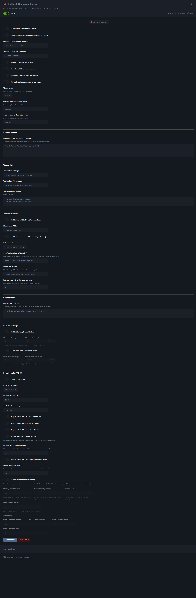
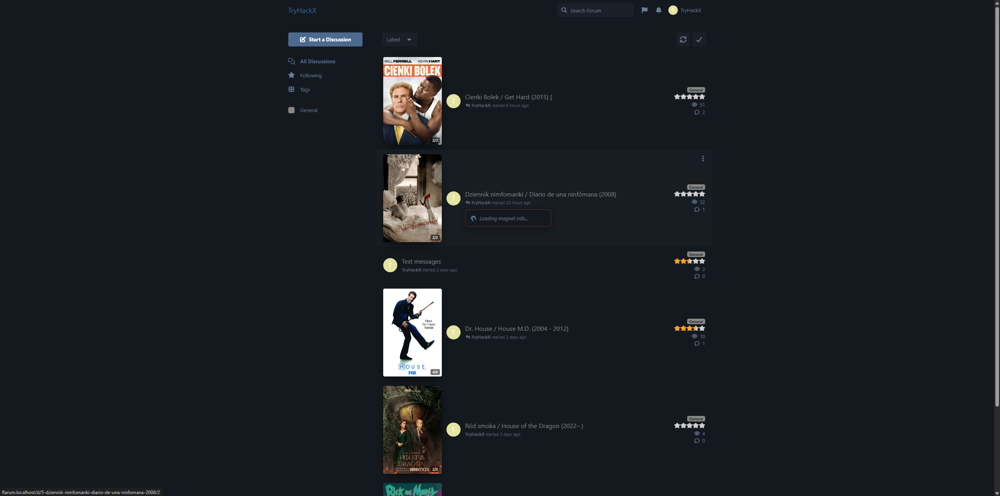

# TryHackX Homepage Blocks

A Flarum extension that adds powerful customisable homepage blocks:
tracker information panels, dual statistics (internal database + external
OpenTracker), advanced discussion filters, content-validation overrides,
and a per-IP rate limiter.

> Designed to plug cleanly into a tracker-style Flarum forum. Works hand
> in hand with the rest of the TryHackX extension family —
> [`tryhackx/flarum-topic-rating`](https://github.com/TryHackX/flarum-topic-rating)
> unlocks rating filters and sorts, [`tryhackx/flarum-magnet-link`](https://github.com/TryHackX/flarum-magnet-link)
> unlocks magnet click stats and sorts, [`fof/discussion-views`](https://github.com/FriendsOfFlarum/discussion-views)
> unlocks view counters / view-based sort.

> **Note:** Recent updates target the **2.x** line only. The **1.x** branch
> (Flarum 1.8+) is **no longer actively developed** — it stays available
> for legacy installs but won't receive new features.

## Screenshots


*Mobile view — discussion list rendered with different combinations of TryHackX extensions (thumbnails + ratings + views, thumbnails + views, thumbnails only, ratings only, views only, vanilla Flarum).*



*TryHackX Homepage Blocks admin panel — section toggles, theme mode, custom filter labels, tracker info / announce URLs, internal & external (OpenTracker) statistics, content title / length overrides and rate-limit settings.*


*Desktop discussion list with the full TryHackX stack — thumbnail sliders on the left, star ratings on the right, magnet button next to each topic.*



*Desktop discussion list — hover state showing the magnet tooltip loading inline (powered by `tryhackx/flarum-magnet-link`).*

## Support Development

If you find this extension useful, consider supporting its development:

- **Monero (XMR):** `45hvee4Jv7qeAm6SrBzXb9YVjb8DkHtFtFh7qkDMxS9zYX3NRi1dV27MtSdVC5X8T1YVoiG8XFiJkh4p9UncqWGxHi4tiwk`
- **Bitcoin (BTC):** `bc1qncavcek4kknpvykedxas8kxash9kdng990qed2`
- **Ethereum (ETH):** `0xa3d38d5Cf202598dd782C611e9F43f342C967cF5`

You can also find the donation option in the extension's admin settings panel.

## Features

- **Tracker info panel** — display BitTorrent tracker announce URLs with
  copy-to-clipboard support, a custom heading and sub-heading.
- **Dual statistics system** — show internal forum stats (from the
  database) and external OpenTracker stats side by side:
  - **Internal stats** — torrents, users, magnets, downloads, views,
    average rating (pulled from the forum database).
  - **External stats (OpenTracker)** — seeds, leechers, peers, completed
    downloads, uptime, fetched directly from the OpenTracker XML endpoint
    (`/stats?mode=everything`). Leechers are derived as `peers − seeds`
    (OpenTracker's `peers` count is the whole swarm).
  - **Shared cache + single-flight** — the backend fetches the tracker at
    most once per *cache lifetime*, globally, and serves everyone from one
    shared cache; when a fetch is already running, other requests are never
    triggered and get the cached/stale value instead. Configurable **cache
    lifetime**, **max fetch time** (large trackers can take ~a minute to
    compute stats) and client **refresh interval**.
- **Advanced discussion filters** — filter bar for the discussion list
  with 7 filter types:
  - Title search
  - User search
  - Rating interval *(requires `tryhackx/flarum-topic-rating`)*
  - Date interval (Today, 1 day, 1 week, 2 weeks, 1 month, 3 / 6
    months, 1 year)
  - Category (primary tag) and Resolution / add-on (secondary tag)
    selection with **live counts**: every option shows how many discussions
    the list returns if you pick it *together with all the other active
    filters* (title, user, intervals, the other tag list), recalculated on
    every change — so a number never promises results that aren't there.
  - Sort by — creation date (always available), plus a **Steam-DB-style
    confidence rating**, average rating, rating count and recently rated
    *(with `tryhackx/flarum-topic-rating`)*, views *(with `fof/discussion-views`)*,
    and magnet clicks total / top magnet / recently clicked
    *(with `tryhackx/flarum-magnet-link`)*. Options whose extension isn't
    installed are hidden automatically.
  - Sort direction (ascending / descending)
- **More filters** (2.8.0, opt-in) — a collapsible panel at the bottom right of
  the filter bar, plus extra sorts. **Every filter is a separate admin switch**
  (all off by default — nothing changes until you turn them on):
  - **Type: movies / series** — an *All / Movies / Series* switch next to the
    *More filters* button (or, per admin setting, a list in the main row or a
    field inside the panel); with live counts like the tag lists.
  - **Size** from – to (MB / GB / TB), **release year** (a series or trilogy
    matches when its years overlap), **running time**, **seasons**,
    **episodes**, **IMDb** and **Filmweb** rating — read from each discussion's
    title and first post (see *Metadata index* below).
  - Everything the list can be sorted by, as a range: **Steam DB rating** (%),
    **average rating**, **number of ratings** and **last rated** *(topic-rating)*,
    **views** *(discussion-views)*, **replies**, **magnet clicks** (all
    magnets / top magnet), **last magnet click** and **with / without a magnet
    link** *(magnet-link)*, **date started** and **last activity** (dates in
    the visitor's own time zone).
  - The panel groups its fields (*Release*, *Ratings & popularity*, *Dates*)
    and starts collapsed on every visit unless the admin makes it open by
    default.
  - Extra sort options: **size** and **release year** (unknown values last).
  - Live counts of the Category / Resolution / Type lists include these filters;
    an invalid range (*from* > *to*) is flagged and never sent; the panel's
    open / closed state is remembered per browser.
- **Metadata index** (for the size / type / year / … filters) — release data
  is read once per discussion into an indexed table, so filtering stays a
  plain index lookup even on big forums. Kept current automatically (new
  discussion, first-post edit, rename, delete); rebuilt from the admin panel
  (batched, resumable, with progress and a per-discussion *preview* of what the
  parser reads) or with `php flarum homepage-blocks:reindex [--only-stale]`.
  Everything the parser looks for is configurable: the field labels
  (`Size:`, `Seasons:`, `Year:` …, comma separated, matched literally), which
  size sources to use (magnet `xl=` exact length → a `Size:` line → a size in
  the title), binary or decimal units, and the series rules (a kind field such
  as `Serial: TV Series`, seasons / episodes values, `S01E01` markers). Posts
  are read as plain text, so BBCode,
  Markdown and literal markup all work.
- **Content-validation overrides** — override Flarum's built-in title
  and content length limits without patching core:
  - Title length: 1–200 characters (`varchar(200)` column max).
  - Content length: 0–16,000,000 characters (`mediumtext` column max).
  - Each toggle is independent.
- **Rate limiting** — a built-in per-IP **points limiter** on the search /
  filters action. Each visitor has a budget that refills over time; when it
  runs out the IP is **temporarily blocked** for a configurable duration and
  the visitor sees a friendly countdown. Client IPs are resolved from Flarum
  core (proxy-aware), so the limit can't be bypassed with a spoofed
  `X-Forwarded-For` header. The per-IP budget is kept on the local filesystem
  with per-IP locking — ideal for a single server; if you run several app
  servers behind a load balancer, front them with a shared store (Redis).
  - **Enforced server-side.** The authoritative charge is a middleware on
    core's `GET /api/discussions` that meters requests carrying the heavy
    `filter[title]` / `filter[user]` (LIKE `%…%`) parameters — so bots,
    scrapers and flooders hitting the API **directly** are throttled and
    blocked *before* the query touches the database, not just users of the
    on-page filter bar. The client-side pre-flight is kept purely for UX
    (instant countdown before a query fires); to avoid double-billing, a
    successful pre-flight grants a short-lived per-IP *grace* that the
    middleware consumes for the follow-up real request. Only heavy
    searches are metered — a title/user filter of 3+ characters, or a
    *More filters* range no index can serve (Steam DB score, magnet clicks);
    ordinary browsing, short (<3-char) filters and light changes (a tag, the
    sort, an indexed range) are never charged, and the filter bar runs its
    pre-flight only for heavy searches. (A shared cache such as Redis is still
    recommended if you run several app servers, so the per-IP bucket is
    consistent across nodes.)
- **Collapsible sections** — Section 1 (tracker + stats) can be
  collapsed by default to save space.
- **Hide hero banner** — optional toggle to hide Flarum's default hero
  banner.
- **Tag filtering** — show only tags that actually have discussions *under
  the current filters* (the picked tag always stays listed), optionally with
  the live counts next to tag names.
- **Light / dark mode** — the blocks follow Flarum 2's colour scheme live
  (header theme switcher, user preference, OS setting, high-contrast modes),
  using the forum's own theme colours. The *Theme mode* setting can instead
  pin the forum's light or dark palette.
- **Two styles** — *Fitted* blends the blocks into the forum; *Original* is a
  card design (rounded cards, primary-tinted header with an accent bar, stat
  tiles with icon chips, pill-shaped tracker URLs). Both use the forum's
  colours and follow light / dark mode.
- **Tracker whitelist sync** (2.6.0) — when your OpenTracker runs in
  *whitelist mode* (only registered info hashes are served — see
  [tryhackx-tracker](https://github.com/TryHackX/tryhackx-tracker) ≥ 1.2.0),
  every magnet link posted on the forum is registered on the tracker
  automatically: new posts, edits and (with `flarum/approval`) approvals are
  pushed live through the tracker's server-to-server API (bearer key), and a
  **Scan whole forum** button walks all visible posts in small batches
  (one request per batch, well inside the PHP time limit, resumable). Failures
  never block a post: short timeout + failure cooldown + one-line logging.
  The API secret is stored server-side only (never sent to the admin
  frontend) and saved through its own endpoint.
- **Topic descriptions for the tracker** (2.10.0) — optionally, the first
  post of every topic with synced magnets is sent to the tracker as the
  description of its torrents (see
  [Tracker whitelist sync — topic descriptions](#tracker-whitelist-sync--topic-descriptions)).
- **Polish & English locales** — fully translated UI.

## Requirements

- Flarum `^2.0.2`
- PHP `^8.3` (matches Flarum 2.x's own minimum); `ext-curl` for the tracker
  statistics fetch and the whitelist sync
- `flarum/tags` (required)
- For **Tracker whitelist sync**: [tryhackx-tracker](https://github.com/TryHackX/tryhackx-tracker)
  ≥ 1.2.0 with `tracker_mode = whitelist`, an API client created in its admin
  panel (Whitelist → API clients) and the tracker's *API ban exempt IPs* list
  containing this forum's outbound IP (a wrong secret from a non-exempt IP is
  banned for 30 days by design). Topic descriptions need tryhackx-tracker
  ≥ 1.78.0 with *Descriptions from the forum* switched on for the API key.

### Recommended companions

These aren't strictly required but unlock additional functionality:

- [**fof/discussion-views**](https://github.com/FriendsOfFlarum/discussion-views)
  — view count statistics and view-based sorting.
- [**tryhackx/flarum-topic-rating**](https://github.com/TryHackX/flarum-topic-rating)
  — rating-based filtering and sorting (Steam-DB-style, average rating, etc.).
- [**tryhackx/flarum-magnet-link**](https://github.com/TryHackX/flarum-magnet-link)
  — magnet click statistics (tracker stats block) and topic-scoped
  magnet-click sorts (clicks total / top magnet / recently clicked).

## Installation

```bash
composer require tryhackx/flarum-homepage-blocks
php flarum cache:clear
```

## Updating

```bash
composer update tryhackx/flarum-homepage-blocks
php flarum migrate
php flarum cache:clear
```

Using the *More filters* index-based filters? Build the index once after
enabling them (admin → *Index* → *Rebuild index*, or
`php flarum homepage-blocks:reindex`).

## Configuration

1. Navigate to the **Administration** panel.
2. Find **TryHackX Homepage Blocks** in the extensions list and enable it.
3. Click the extension to access the configuration sections:

| Section | Description |
| --- | --- |
| **General** | Section titles, default-collapsed state, hero banner toggle, tag display options, theme mode (auto / light / dark) and style (fitted / original). |
| **Tracker Info** | Tracker heading, sub-heading, announce URLs. |
| **Tracker Statistics** | Toggle internal stats, set the OpenTracker XML URL, cache lifetime, max fetch time and client refresh interval. |
| **Content Settings** | Override title and content length limits. |
| **Rate limiting** | Per-IP points limiter on search/filters. When a visitor runs out of points the IP is temporarily blocked (configurable duration and post-block budget reset). Guests pay an extra per-action cost. |
| **Tracker whitelist sync** | Enable toggle (reveals the settings), tracker URL, API key ID, API secret (own *Save secret* button — stored server-side only), live-sync timeout, optional bare-hash detection, **Test connection** and **Scan whole forum** with a progress bar (batched, resumable). |
| ↳ **Only sync magnets that point at our tracker** (2.6.1) | Off by default. When on, a hash is sent only if its magnet link has a `tr=` announce URL on one of the **Tracker hosts** (comma / newline separated hostnames or IPs, e.g. `tracker.example.org, 203.0.113.10`; `host:port` / full URLs accepted, case-insensitive). Hashes without a magnet (bare `btih:` / bare 40-hex) are skipped; the scan reports them as *skipped*. An empty host list sends nothing and is reported on the last-error line. |
| ↳ **Send topic descriptions to the tracker** (2.10.0) | Off by default. Sends each topic's first post to the tracker as the description of its torrents — see below. |
| **Advanced filters** (2.8.0) | Master switch (off by default), panel expanded by default, one switch per filter (filters needing a missing extension are greyed out), Type position / field name, extra sorts, **How release data is read from posts** (size sources, units, labels, series rules — placeholders show the defaults) and the **Index** card (status, *Rebuild index*, *Only missing / outdated*, per-discussion preview). After enabling an index-based filter, rebuild the index once; after changing the parser rules, save and rebuild. |

### Tracker whitelist sync — topic descriptions

With **Send topic descriptions to the tracker** on (and the whitelist sync
itself on), a topic's first post is sent to the tracker's
`v1/whitelist/describe` endpoint right after its magnets went through
`v1/whitelist/submit`. The tracker uses it as the description of those
torrents — held for its moderators or published at once, as set for the API
key on the tracker (*Descriptions from the forum*, tryhackx-tracker ≥ 1.78.0).

- **What is sent** — the discussion id and link, the first post's id, its
  author (id and display name; nothing for a deleted user), its last edit
  time (or creation time), its source text exactly as the author typed it
  (BBCode / Markdown as written, not the rendered HTML), its length in
  characters and the info hashes found in it — the same extraction and the
  same *Only sync magnets that point at our tracker* filter as the magnet
  sync. More than 20 hashes are sent as several topics of the same post.
- **Length limit** — the forum's own content limit is sent with every request
  (`max_chars`): the *Maximum content length* of **Content Settings** while
  *Enable content length modification* is on, core's 63,000 characters while
  it is off — the same value posts are validated with. A post longer than that
  (written before the limit was lowered) goes without its text, with its
  length only. The tracker keeps descriptions up to that limit, at most
  1,000,000 characters, and reports longer ones as *too long*.
- **When** — on a new discussion, on every edit of its first post and when
  flarum/approval approves it; never for a reply, a hidden or private post,
  or a post still awaiting approval. Like the magnet sync it runs after the
  response is sent and never blocks posting.
- **Scan whole forum** sends and refreshes the descriptions of every topic it
  passes (calls of at most 25 topics, about 3.5 MB each). If a batch runs out
  of time half-way, the next batch starts after the last post whose
  description went out, so nothing is skipped. The progress line counts
  descriptions *accepted* (created, queued, updated, replaced or proposed),
  *unchanged*, *kept* (edited on the tracker and left as they are), *too
  long*, *invalid* and *skipped* (hash not registered, banned, described from
  another topic, removed or declined on the tracker).
- **Descriptions off on the tracker** — if the key's descriptions are off,
  magnets keep syncing and descriptions pause for 10 minutes (a Test
  connection that shows them on again resumes them at once); the scan says so
  once. **Test connection** shows the key's description mode.

### Advanced filters — API

The panel sends ordinary `GET /api/discussions` filters, so they also work for
API clients. Ranges are `min..max` with either side optional (`10GB..`,
`..2010`, `5..20`); malformed values are ignored, `-key` negates. A disabled
filter is ignored server-side too.

| Filter | Value |
| --- | --- |
| `filter[mediaType]` | `movie` / `series` |
| `filter[sizeRange]` | numbers with an optional unit `B`, `KB`…`TB`, `KiB`…`TiB` (default `GB`) |
| `filter[yearRange]`, `filter[seasonsRange]`, `filter[episodesRange]`, `filter[durationRange]` (minutes) | numbers |
| `filter[imdbRange]`, `filter[filmwebRange]` (0–10), `filter[ratingRange]` (0–5), `filter[steamRange]` (0–100 %), `filter[ratingCountRange]`, `filter[viewsRange]`, `filter[repliesRange]`, `filter[clicksRange]`, `filter[clicksTopRange]` | numbers |
| `filter[createdRange]`, `filter[activeRange]`, `filter[ratedRange]`, `filter[clickedRange]` | unix timestamps or `YYYY-MM-DD` (UTC day, end day included) |
| `filter[hasMagnet]` | `1` / `0` |
| `sort` | `-hbSize` / `hbSize`, `-hbYear` / `hbYear` |

The Steam DB score (filter and sort) uses SQL `POWER()` — available on
MySQL, MariaDB and PostgreSQL; on SQLite it needs a build with math functions.

## API endpoints

| Method | Path | Purpose |
| --- | --- | --- |
| `GET` | `/api/tryhackx/homepage/stats` | Forum / tracker statistics (served from a shared server-side cache). |
| `POST` | `/api/tryhackx/homepage/points/check` | Rate-limiter pre-flight for a search (`?action=search`, `&facets=1` when the live counts will be fetched too). |
| `GET` | `/api/tryhackx/homepage/facets` | Live Category / Resolution (and Type) counts for the filter bar: `filter[title|user|dateInterval|ratingInterval]` and the *More filters* keys, `category=<slug|all>`, `resolution=<slug|all>` → `{category: {total, counts: {tagId: n}}, resolution: {…}, mediaType: {total, movie, series}}` (`mediaType` only while the Type filter is on). Same filters and visibility as the discussion list; heavy title/user searches go through the rate limiter (range filters are index lookups and aren't metered). |
| `GET` | `/api/tryhackx/homepage/meta/status` | Admin only — Advanced Filters index status (`total, indexed, missing, stale, with_size, series, movies`) + the parser defaults. |
| `POST` | `/api/tryhackx/homepage/meta/reindex` | Admin only — one batch of the index rebuild (`{cursor, only_stale?}` → `{next_cursor, done, processed, elapsed_ms, status?}`); single-flight (409 while another batch runs). |
| `GET` | `/api/tryhackx/homepage/meta/preview?id=N` | Admin only — what the parser reads from discussion N with the current settings, next to what the index holds. |
| `POST` | `/api/tryhackx/homepage/whitelist/test` | Admin only — pings the tracker API with the (unsaved) settings and reports mode / whitelist size / clock skew / description mode (`describe`: `off`, `queue`, `publish` or `null` for an older tracker). |
| `POST` | `/api/tryhackx/homepage/whitelist/scan` | Admin only — one batch of the forum scan (`{cursor}` → `{next_cursor, done, processed, hashes_found, skipped_no_tracker, added, exists, banned, describe, …}`, `describe` = `{described, unchanged, kept, too_long, invalid, skipped, off}` or `null` while descriptions are off); on a tracker error the cursor is not advanced. |
| `POST` | `/api/tryhackx/homepage/whitelist/secret` | Admin only — stores / clears the tracker API secret (accepts a full `key_id.secret` token). |

## Development & tests

```bash
composer install
composer test:setup        # one-off: installs a throw-away Flarum (SQLite by default)
composer test              # PHP unit + integration tests
cd js && npm ci && npm run build
```

The integration suite sends real API requests to a test install (SQLite unless
`DB_DRIVER` / `DB_HOST` / `DB_PORT` / `DB_DATABASE` / `DB_USERNAME` /
`DB_PASSWORD` / `DB_PREFIX` point at a MySQL, MariaDB or PostgreSQL **test**
database — all its tables are dropped).

## Links

- [GitHub](https://github.com/TryHackX/flarum-homepage-blocks)
- [Packagist](https://packagist.org/packages/tryhackx/flarum-homepage-blocks)
- [Report Issues](https://github.com/TryHackX/flarum-homepage-blocks/issues)

## License

MIT License. See [LICENSE](LICENSE) for details.
